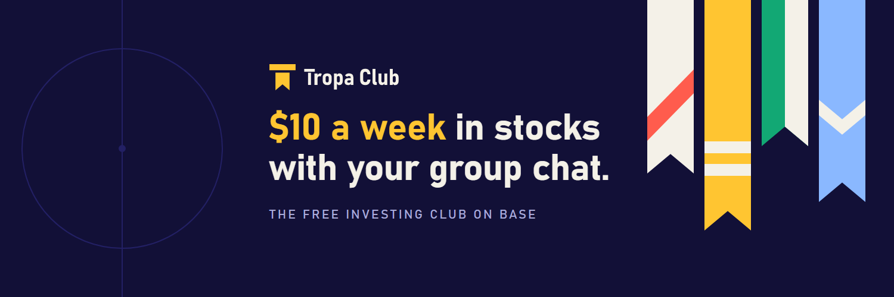

# Tropa Club

Tropa Club is a free place to invest with friends. People start a club in a group chat, pick stocks together, and follow the club through weekly gameweeks, a league table and a Matchday card. The stocks are Coinbase B20 stock tokens on Base. Everyone buys from their own wallet, and Tropa Club never holds anyone's funds.

- Site: https://tropaclub.xyz
- Docs: https://docs.tropaclub.xyz
- X: https://x.com/tropaclubxyz
- Data feed: https://storage.googleapis.com/tropaclub-data/public/ (start with `index.json`; the files are `index.json`, `tokens/<symbol>.json`, `wallets/<2hex>.json` and `stats.json`, described in the data feed docs)

## How it works

1. **Indexer** (`indexer/`). Every 6 hours it counts every holder of each B20 stock token on Base, sorts real fans from dust, giveaway wallets, contracts and pools, and publishes the result as public JSON.
2. **The Ground** (`web/`). Each stock gets a ground: one seat per holder wallet, real fans lit up, and a matchday ticket for each wallet.
3. **Clubs** (`clubs/`). Group-chat clubs with seats, weekly gameweeks, fixtures, the league, Matchday and payday streaks. State lives in Firestore.
4. **Buying and attribution** (`buy/`). A buy goes through the KyberSwap router into Aerodrome Slipstream pools. Each transaction carries our Builder Code (`bc_vdp89s9b`) as an ERC-8021 data suffix. A buy only counts for a club once its receipt checks out:
   - the pinned router logged a `Swapped` event for the wallet;
   - the payment went to the router side, and the stock came out of a verified Aerodrome pool;
   - the fill was within 10% of the Chainlink mark in market hours, or 20% outside them;
   - the cost basis recorded is the higher of the mark and the fill, so a stale mark can never inflate a return.

## Repository layout

| Path | What it holds |
|---|---|
| `web/` | The Next.js app: The Ground, tickets, club pages, API routes. See `web/DESIGN.md`. |
| `clubs/` | The server-side clubs engine (TypeScript library, Firestore or in-memory store) and the Firestore rules. |
| `buy/` | The buy engine: quotes, price guard, swap calls, ERC-8021 suffix, simulation. It never signs or sends. |
| `indexer/` | The holder indexer and its public JSON output. |
| `shared/` | Types shared between packages. |
| `docs/` | The static docs site served at docs.tropaclub.xyz. |
| `infra/` | Build and hosting configuration. |
| `geo/` | The country database used by the region gate. |

## Running locally

Node 20 or newer.

```
cd web && npm ci && npm run dev     # http://localhost:3055
```

With no Firestore configured, the app runs on sample data and an in-memory store. Environment variables are listed by name, with comments, in `web/.env.example`; copy it to `web/.env.local` and fill in only what you need.

Tests, per package (run `npm ci` in each first):

```
cd buy     && npm run test:unit
cd clubs   && npm test               # in-memory store
cd clubs   && npm run test:emulator  # same suites plus Firestore rules, on the Firestore emulator (needs a JDK)
cd web     && npm test
cd indexer && npm run typecheck
```

`npm run typecheck` is available in `web/`, `clubs/` and `buy/`.

## Security notes

- **No custody.** Users buy from their own wallets. The site never holds funds or keys.
- **Pinned contracts.** Only one KyberSwap router and its executor are accepted. A transaction that does not show a swap through them by the buyer's wallet is not counted.
- **Receipt verification.** Every buy is checked from its on-chain receipt, not from what the browser reports.
- **Region gate.** Buying is blocked for the US and its territories, sanctioned countries, Tor exits, and when the country cannot be determined.
- **Sessions.** Sign-in is SIWE. The session is an httpOnly cookie carrying a per-wallet session version, so signing out revokes it everywhere.
- **Origin.** The API only answers on tropaclub.xyz.
- **Firestore rules.** Clients can read only public aggregates; all other reads and writes go through the server.

To report a vulnerability, open a private security advisory on this repository (Security tab, "Report a vulnerability"). Please do not open a public issue.
